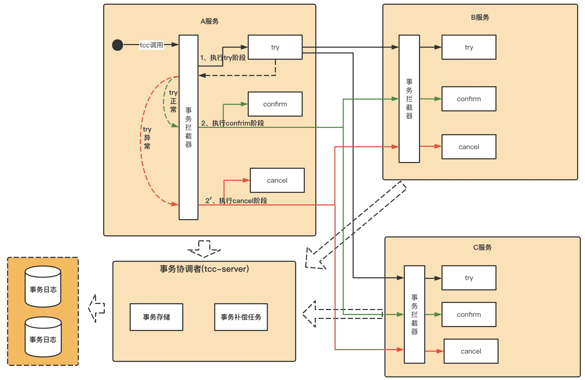

# 背景
因为在职级答辩中，有个同学在发货系统的设计中，讲到了tcc的机制，另外在支付的虚拟币中也有tcc的分支实现代码，基于这个背景，我初步研究了下tcc，但是你说实操的话，经验倒没有很深入.

# why
- 数据库基础中，我们都支持数据库可以实现事务，去较好的实现一件事的多个操作
- 但是在分布式服务体系下，会做微服务化以及分库逻辑，从而导致多个逻辑的实现不在一起（mysql客户端和mysql服务器不是1v1，在一个事务连接上），为了解决这个场景下的问题，分布式事务就出现了.

# what
- tcc是三个单词的缩写，try(预处理)/confirm(确认)/cancel（撤销）
- try：做业务检查及资源预留
- confirm：做业务确认操作
- cancel：实现一个与Try相反的操作即回滚操作
- 属于两段式提交的分布式事务


# how
## 流程图

- 第一阶段，事务发起者分别调用所有分支事务的try方法，当全部成功或者某个分支失败的时候，进入第二阶段
- 第二阶段：全部成功，执行confirm；单个失败执行cancel


## 幂等&&空回滚&&防悬挂
- 应对接口的网络调用失败，可以增加重试提升成功率，所以相关接口都需要实现幂等性
- 如果try接口一直失败，那么在调用cancel的时候，可能没有东西回滚，那么我们的系统要允许空回滚
- 空回滚的时候，try接口逻辑也可能在执行过程中，那么这种情况，我们要通过定时任务的补偿机制，去扫描事务状态，自动释放资源，防止资源悬挂


## 具体案例场景
- 使用tcc-transaction中demo例子来讲,主要是下单的支付流程，分支包括订单、资产和红包三个分支角色
```
订单：
    try: 创建订单，变为待支付状态
    confirm: 订单变为confirm状态
    cancel: 订单变为支付失败状态

资产：
    try: 插入流水记录，扣钱
    confirm：转钱到目标账户
    cancel: 取消扣钱

红包：红包服务和资产服务的逻辑差不多

```

## 具体源码实现
- [tcc-transaction](https://github.com/changmingxie/tcc-transaction)


# 参考
- [B站分析视频](https://www.bilibili.com/video/BV1eCsczuESP/?share_source=copy_web&vd_source=384ca8380e2ca8fd89eb69bfc22095ea)


